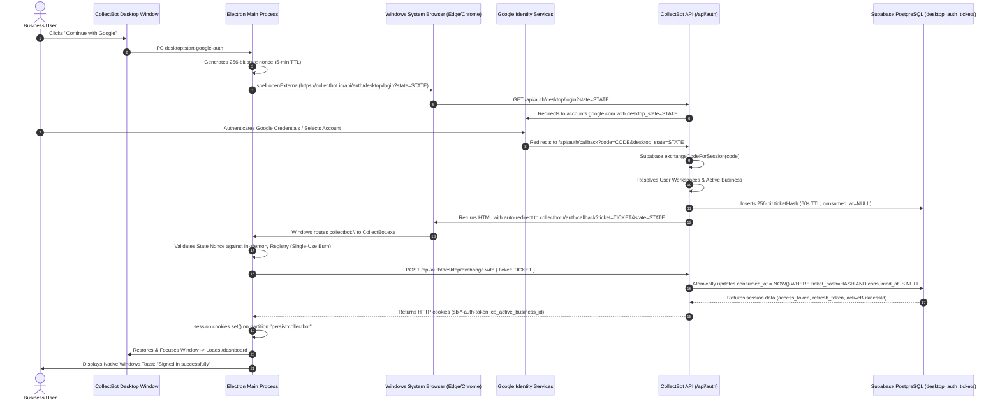

# COLLECTBOT DESKTOP — GOOGLE OAUTH & DEEP-LINK SPECIFICATION (PHASE 3)

**Document Version:** 1.0.0  
**Date:** November 11, 2026  
**Status:** **IMPLEMENTED & VERIFIED** (RFC 8252 Compliant)  
**Target:** Windows x64 Desktop Application Shell  

---

## 1. WHY SYSTEM BROWSER OAUTH IS REQUIRED

Google actively restricts OAuth authentication originating from embedded webviews and Electron browsers, returning:
> **Error 403: disallowed_useragent**  
> *"This browser or app may not be secure. Learn more. Try using a different browser."*

In accordance with **RFC 8252 (OAuth 2.0 for Native Apps)**, native desktop applications must delegate interactive user authentication to the user's default system browser (Google Chrome, Microsoft Edge, Mozilla Firefox, Brave), where users can take advantage of existing browser sign-in sessions, biometric credentials (Windows Hello / Passkeys), and password managers.

---

## 2. END-TO-END OAUTH SEQUENCE



---

## 3. TICKET LIFECYCLE & SECURITY GUARANTEES

### 3.1 256-Bit Cryptographic Entropy
Tickets are generated using `node:crypto`'s cryptographically secure pseudo-random number generator (CSPRNG):
```typescript
const rawTicket = crypto.randomBytes(32).toString("hex") // 256 bits entropy
```

### 3.2 Hashed Storage
The raw ticket is never stored in the database. The server stores only the SHA-256 digest:
```typescript
const ticketHash = crypto.createHash("sha256").update(rawTicket).digest("hex")
```
Even in the event of an unauthorized database snapshot read, an attacker cannot invert the hash to deduce the valid ticket within its 60-second validity window.

### 3.3 60-Second Time-To-Live (TTL)
Tickets carry an absolute expiration timestamp:
```typescript
const expiresAt = new Date(Date.now() + 60 * 1000)
```
Any redemption request received after 60 seconds is rejected with HTTP `401 Unauthorized`.

### 3.4 Single-Use & Replay Protection
Redemption is executed via an atomic PostgreSQL `UPDATE` with a conditional filter:
```sql
UPDATE desktop_auth_tickets
SET consumed_at = NOW()
WHERE ticket_hash = $1
  AND consumed_at IS NULL
  AND expires_at > NOW()
RETURNING session_data;
```
If two requests arrive simultaneously or an attacker replays an intercepted ticket, exactly one transaction will return the session payload; all subsequent attempts return zero rows and are rejected.

### 3.5 State Nonce & CSRF Protection
Before launching the external browser, the Electron Main process generates an ephemeral 32-byte hexadecimal `state` nonce and registers it in memory. When the deep link returns:
```typescript
const isStateValid = verifyAndConsumeAuthState(state)
if (!isStateValid) {
  // Reject: prevent login CSRF and session injection
}
```

---

## 4. WINDOWS PROTOCOL REGISTRATION (`collectbot://`)

The protocol is registered on Windows application startup:
```typescript
if (process.defaultApp) {
  if (process.argv.length >= 2) {
    app.setAsDefaultProtocolClient("collectbot", process.execPath, [path.resolve(process.argv[1])])
  }
} else {
  app.setAsDefaultProtocolClient("collectbot")
}
```

### Protocol Validation Rules
1. **Scheme Validation:** `url.protocol === "collectbot:"`.
2. **Host & Path Validation:** `url.hostname === "auth"` and `url.pathname === "/callback"`.
3. **Parameter Validation:** Both `ticket` and `state` parameters must be non-empty strings.
4. **Single Execution:** Second-instance events forward `argv` directly to `handleDeepLink(url)`. Cold-start invocations process `process.argv` on initial window readiness.

---

## 5. PERSISTENT SESSION ESTABLISHMENT

Once the ticket is exchanged, the session is written directly to Chromium's encrypted cookie store via Electron's Session API:
```typescript
await persistentSession.cookies.set({
  url: targetUrl,
  name: exchangeData.supabaseCookie.name,
  value: exchangeData.supabaseCookie.value,
  path: "/",
  secure: !isDev,
  httpOnly: true,
  sameSite: "lax",
  expirationDate: Math.floor(Date.now() / 1000) + 60 * 60 * 24 * 30, // 30 days
})

await persistentSession.cookies.set({
  url: targetUrl,
  name: "cb_active_business_id",
  value: exchangeData.activeBusinessId,
  path: "/",
  secure: !isDev,
  httpOnly: false,
  sameSite: "lax",
  expirationDate: Math.floor(Date.now() / 1000) + 60 * 60 * 24 * 30,
})
```

Because the session is mounted on `persist:collectbot`, cookies are encrypted by Chromium using the Windows Data Protection API (DPAPI). When the user closes CollectBot and launches it days later, the session is restored instantly, and Supabase SSR automatically refreshes the JWT access token in the background.

