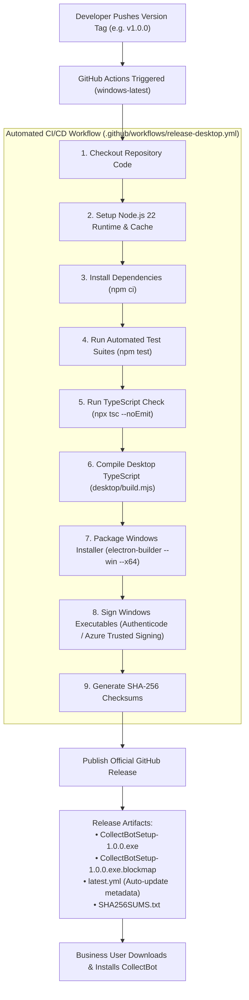

# COLLECTBOT DESKTOP CONVERSION — RELEASE & CI/CD PIPELINE GUIDE (PHASE 1)

**Document Version:** 1.0.0  
**Date:** November 11, 2026  
**CI/CD Engine:** GitHub Actions  
**Release Host:** GitHub Releases (`aryan24-cs/CollectBot`)  
**Target Output:** `CollectBotSetup-<version>.exe` (Windows x64 NSIS)  

---

## 1. RELEASE ARCHITECTURE OVERVIEW

The desktop release pipeline automates building, packaging, verifying, and distributing Windows installers directly to end users without requiring manual developer intervention.



---

## 2. SEMANTIC VERSIONING & TAGGING SPECIFICATION

CollectBot Desktop follows **Semantic Versioning 2.0.0** (`MAJOR.MINOR.PATCH`):
- `MAJOR` (e.g. `2.0.0`): Breaking architectural changes or complete protocol overhaul.
- `MINOR` (e.g. `1.1.0`): New desktop native features (e.g., native print preview, system tray notifications, offline cache).
- `PATCH` (e.g. `1.0.1`): Bug fixes, security patches, Electron dependency updates.

### Release Initiation Protocol
To publish a new desktop release:
```bash
# 1. Update version in package.json
npm version 1.0.0 --no-git-tag-version

# 2. Commit version bump
git commit -am "chore(release): bump desktop version to 1.0.0"

# 3. Create annotated git tag
git tag -a v1.0.0 -m "CollectBot Desktop v1.0.0 (Windows x64 Production Release)"

# 4. Push branch and tag to GitHub
git push origin master
git push origin v1.0.0
```

---

## 3. GITHUB ACTIONS RELEASE WORKFLOW DESIGN

The release workflow is designed to execute on native `windows-latest` runners to ensure authentic Windows build toolchain compatibility.

### Proposed Workflow File: `.github/workflows/release-desktop.yml`
```yaml
name: Release CollectBot Desktop

on:
  push:
    tags:
      - 'v*'

permissions:
  contents: write

jobs:
  build-and-release:
    name: Build & Publish Windows Installer
    runs-on: windows-latest

    steps:
      - name: Checkout Code
        uses: actions/checkout@v4
        with:
          fetch-depth: 0

      - name: Setup Node.js
        uses: actions/setup-node@v4
        with:
          node-version: 22
          cache: 'npm'

      - name: Install Dependencies
        run: npm ci

      - name: Run Core Test Suite
        run: npm test

      - name: Run Static Typecheck
        run: npx tsc --noEmit

      - name: Compile Desktop Preload & Main
        run: npm run desktop:compile

      - name: Build & Publish via Electron Builder
        env:
          GH_TOKEN: ${{ secrets.GITHUB_TOKEN }}
          # Optional Code Signing Certificates (if configured)
          CSC_LINK: ${{ secrets.WIN_CSC_LINK }}
          CSC_KEY_PASSWORD: ${{ secrets.WIN_CSC_KEY_PASSWORD }}
        run: npx electron-builder --win --x64 --publish always

      - name: Generate Checksums
        shell: pwsh
        run: |
          Get-ChildItem -Path dist/*.exe | ForEach-Object {
            $hash = (Get-FileHash -Path $_.FullName -Algorithm SHA256).Hash
            "$hash  $($_.Name)" | Out-File -FilePath dist/SHA256SUMS.txt -Append -Encoding utf8
          }

      - name: Upload SHA256 Checksum to Release
        uses: softprops/action-gh-release@v2
        with:
          files: dist/SHA256SUMS.txt
```

---

## 4. CODE SIGNING & WINDOWS SMARTSCREEN STRATEGY

### 4.1 The Unsigned Binary Problem
When users download an unsigned `.exe` from the web, Windows SmartScreen displays:
> "Windows protected your PC — Microsoft Defender SmartScreen prevented an unrecognized app from starting."

Users must manually click *"More info"* and *"Run anyway"* to install the application.

### 4.2 Remediation Paths
1. **Initial Open Source / Soft Launch Phase (Unsigned):**
   - Provide clear installation documentation showing users how to bypass SmartScreen during initial deployment.
   - Publish cryptographic SHA-256 checksums alongside every release so users can verify installer integrity.
2. **Production Commercial Signing (Recommended for General Availability):**
   - **Option A (Azure Trusted Signing):** Microsoft's modern, cloud-based code signing solution (cost-effective, integrates seamlessly with GitHub Actions without physical USB hardware tokens).
   - **Option B (EV Code Signing Certificate):** Instantly eliminates SmartScreen warnings from day one across all Windows machines.
   - Configure signing credentials in GitHub Secrets:
     - `WIN_CSC_LINK`: Base64-encoded PFX certificate.
     - `WIN_CSC_KEY_PASSWORD`: Certificate password.

---

## 5. AUTO-UPDATE ARCHITECTURE (`electron-updater`)

CollectBot Desktop supports seamless background auto-updating powered by GitHub Releases.

### How It Works
1. When a new version is released on GitHub, `electron-builder` generates and uploads:
   - `CollectBotSetup-<version>.exe`
   - `latest.yml` (Contains version number, release date, and SHA-512 hashes).
2. On startup, the desktop application runs `desktop/src/updater.ts`:
   ```typescript
   import { autoUpdater } from "electron-updater"

   export function initAutoUpdater() {
     autoUpdater.autoDownload = true
     autoUpdater.autoInstallOnAppQuit = true

     autoUpdater.on("update-available", (info) => {
       console.log(`Update available: v${info.version}`)
     })

     autoUpdater.on("update-downloaded", () => {
       // Notify user via UI or tray that update will apply on next restart
     })

     autoUpdater.checkForUpdatesAndNotify()
   }
   ```
3. Because the core web app is hosted on Vercel, **feature updates to invoices, sales, and marketing deploy instantly to web and desktop without requiring a desktop app update**.
4. Desktop binary updates are only needed when updating the Electron runtime, native drivers, or preload bridges.

