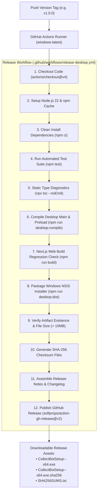

# CollectBot Desktop — Release Pipeline & CI/CD Specification

**Workflow:** `.github/workflows/release-desktop.yml`  
**Trigger:** Annotated Git Tags (`v*.*.*`)  
**Runner:** Native `windows-latest` (GitHub-hosted)  
**Runtime:** Node.js 22.x | npm Lockfile (`package-lock.json`)  
**Packaging Engine:** `electron-builder` v26.18.0 + NSIS  
**Target Output:** `CollectBotSetup-<version>-x64.exe`  

---

## 1. Release Architecture Overview

The CollectBot Desktop release pipeline provides an automated, reproducible, and cryptographically verified build process. Releases are triggered strictly by version tags and execute on clean Windows runners with zero manual intervention.



---

## 2. Mandatory Quality & Security Gates

Every release must pass all the following gates in order. Any single failure will immediately abort the pipeline and prevent the release from publishing:

| Gate # | Pipeline Stage | Command | Success Condition |
| :---: | :--- | :--- | :--- |
| **Gate 1** | Dependencies | `npm ci` | Clean installation strictly matching `package-lock.json`. |
| **Gate 2** | Test Suite | `npm test` | 56/56 unit and security regression tests pass (Exit code 0). |
| **Gate 3** | Static Typing | `npx tsc --noEmit` | Zero TypeScript diagnostic errors across Next.js and Electron codebases. |
| **Gate 4** | Desktop Compilation | `npm run desktop:compile` | `desktop/dist/main.js` and `preload.js` generated cleanly via esbuild. |
| **Gate 5** | Web Build Check | `npm run build` | All 74 Next.js production routes build and optimize successfully. |
| **Gate 6** | NSIS Packaging | `npm run desktop:dist` | `electron-builder` completes NSIS compression and generates x64 installer. |
| **Gate 7** | Artifact Verification | PowerShell Check | Installer file exists in `dist/` and file size exceeds 10MB minimum threshold. |
| **Gate 8** | Checksum Integrity | `Get-FileHash -Algorithm SHA256` | Generates reproducible SHA-256 checksum file matching the binary byte-for-byte. |

---

## 3. GitHub Actions Least-Privilege Permissions

The workflow strictly enforces the principle of least privilege:

```yaml
permissions:
  contents: write
```

- **`contents: write`:** Required to create GitHub Release records and upload binary assets.
- **Pull Requests, Issues, and Actions permissions:** Denied / not granted.
- **Branch Protection:** Releases **cannot** be triggered from normal branch pushes (`master`, `develop`). Only authenticated tags matching `v*.*.*` trigger the release workflow.

---

## 4. Release Secret Management

The release workflow is designed to build both unsigned development/preview builds and signed production releases without modification:

| Secret Name | Purpose | Required? |
| :--- | :--- | :---: |
| `GITHUB_TOKEN` | Authorize release creation and asset upload. | Automatic (Built-in) |
| `WIN_CSC_LINK` | Base64-encoded Windows Authenticode `.pfx` or `.p12` certificate. | Optional (For Code Signing) |
| `WIN_CSC_KEY_PASSWORD` | Password for the certificate private key. | Optional (For Code Signing) |

If `WIN_CSC_LINK` is not configured in repository secrets, `electron-builder` automatically logs a notification:
`no code signing certificate configured, signing is skipped` and packages an unsigned installer without failing the build.

---

## 5. Developer Guide: How to Cut a Desktop Release

Follow this procedure to release a new version of CollectBot Desktop:

### Step 1: Verify Local Health
Ensure all tests pass and compilation is clean:
```powershell
npm test
npx tsc --noEmit
npm run desktop:compile
```

### Step 2: Bump Application Version
Update the version number in `package.json`:
```bash
# Example: Bumping to 1.0.0
npm version 1.0.0 --no-git-tag-version
```

### Step 3: Commit and Push
```bash
git add package.json package-lock.json
git commit -m "chore(release): bump desktop version to 1.0.0"
git push origin master
```

### Step 4: Create and Push Version Tag
```bash
git tag -a v1.0.0 -m "CollectBot Desktop v1.0.0 (Windows x64 Production Release)"
git push origin v1.0.0
```

### Step 5: Monitor Release Workflow
1. Navigate to your repository on GitHub: `https://github.com/aryan24-cs/CollectBot/actions`.
2. Monitor the running **Release CollectBot Desktop** workflow.
3. Upon completion, verify the new release under **Releases**:
   - `CollectBotSetup-1.0.0-x64.exe`
   - `CollectBotSetup-1.0.0-x64.exe.sha256`
   - `SHA256SUMS.txt`

