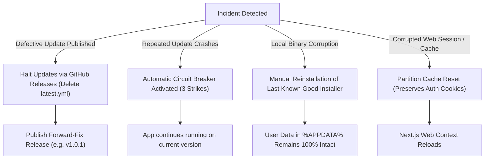

# COLLECTBOT DESKTOP — ROLLBACK, RECOVERY & INCIDENT RESPONSE

**Target Platform:** Windows 10 / Windows 11 (x64)  
**Storage Architecture:** Segregated Partition (`persist:collectbot`)  
**Configuration Path:** `%APPDATA%\CollectBot`  
**Installation Path:** `%LOCALAPPDATA%\Programs\CollectBot`  
**Status:** **PHASE 5 COMPLETE & OPERATIONAL**

---

## 1. INCIDENT SCENARIOS & RECOVERY PROCEDURES

This document details remediation pathways for edge cases, corrupted states, failed updates, and emergency rollback scenarios.



---

## 2. AUTOMATIC CIRCUIT BREAKER & LOOP PREVENTION

CollectBot Desktop protects against continuous crashing or update reboot loops by persisting an operational state file in `%APPDATA%\CollectBot\update-state.json`:

```json
{
  "consecutiveFailures": 3,
  "lastAttempt": "2026-11-11T21:40:00.000Z",
  "lastFailedVersion": "1.0.1",
  "circuitBroken": true
}
```

### Circuit Breaker Trigger:
1. Whenever `electron-updater` encounters an unhandled download, verification, or extraction error, `consecutiveFailures` is incremented.
2. If `consecutiveFailures >= 3`:
   - `circuitBroken` is flagged as `true`.
   - The automatic 4-hour background update timer is completely disarmed.
   - The application does not attempt any further background update downloads or restarts during that application run.
   - The running version continues operating normally, guaranteeing business owners uninterrupted access to invoicing and sales operations.
3. **Resetting the Circuit Breaker:**
   - The user triggers a manual check via `Help -> Check for Updates...`.
   - Or a newer version is successfully installed.

---

## 3. DATA PRESERVATION GUARANTEE

CollectBot Desktop cleanly separates the **application binaries** from **user session data and credentials**:

| Component | Storage Location | Behavior During Update / Reinstall |
| :--- | :--- | :--- |
| **Executable Binaries** | `%LOCALAPPDATA%\Programs\CollectBot` | Overwritten and updated in-place |
| **Authentication Session** | `%APPDATA%\CollectBot\Partitions\persist_collectbot\Cookies` | **Preserved 100%** |
| **Active Business Context** | `cb_active_business_id` cookie in persistent jar | **Preserved 100%** |
| **Update Configuration** | `%APPDATA%\CollectBot\update-config.json` | **Preserved 100%** |
| **Uninstall Policy** | `electron-builder.yml: deleteAppDataOnUninstall: false` | Preserves all user profile data even if uninstalled |

Because session cookies (`sb-*-auth-token`, `cb_active_business_id`) are stored in Chromium's persistent partition directory, **users will never be logged out after an update, crash, or manual reinstall**.

---

## 4. MANUAL ROLLBACK & REINSTALLATION PROCEDURE

If an installed update exhibits an unexpected client-side bug on a user's workstation:

### Step 1: Download Previous Known-Good Installer
Download the previous stable installer (for example, `CollectBotSetup-0.1.0-x64.exe`) from the official GitHub Releases page.

### Step 2: Run Installer Directly
Double-click the installer executable.  
- The NSIS installer will run without requiring administrator elevation.
- It automatically replaces the binaries in `%LOCALAPPDATA%\Programs\CollectBot`.
- The user's `%APPDATA%\CollectBot` directory and partition storage remain completely untouched.

### Step 3: Launch CollectBot Desktop
- CollectBot Desktop launches with the older binary version.
- Existing user authentication cookies and company selections are instantly loaded.

---

## 5. NSIS LIMITATIONS & FORWARD-FIX POLICY

### Why Automatic Downward Updates Are Prohibited:
`electron-updater` is configured with `allowDowngrade = false`. If a client is running `v1.0.0`, publishing `v0.9.0` will be rejected by the updater as older than current. This is standard industry best practice to prevent downgrade attacks against cryptographic libraries.

### The Forward-Fix Strategy:
To roll back a feature across the entire client base:
1. Revert the problematic commit in git.
2. Increment the patch version in `package.json` (e.g. from `v1.0.0` to `v1.0.1`).
3. Build and publish `v1.0.1`.
4. All client installations will automatically upgrade forward from `v1.0.0` to `v1.0.1`, effectively applying the rollback without manual intervention.

---

## 6. WORKSTATION DIAGNOSTICS & LOG LOCATION

When troubleshooting desktop client issues on Windows:

| Data Type | Absolute Windows Path |
| :--- | :--- |
| **Application Executable** | `%LOCALAPPDATA%\Programs\CollectBot\CollectBot.exe` |
| **Application User Data** | `%APPDATA%\CollectBot` |
| **Update Configuration** | `%APPDATA%\CollectBot\update-config.json` |
| **Update State / Circuit** | `%APPDATA%\CollectBot\update-state.json` |
| **Downloaded Update Cache**| `%LOCALAPPDATA%\collectbot-updater\pending` |
| **Session Cookies & Cache** | `%APPDATA%\CollectBot\Partitions\persist_collectbot` |

To reset the local update cache without logging the user out:
```powershell
Remove-Item -Path "$env:LOCALAPPDATA\collectbot-updater" -Recurse -Force -ErrorAction SilentlyContinue
Remove-Item -Path "$env:APPDATA\CollectBot\update-state.json" -Force -ErrorAction SilentlyContinue
```
Restarting CollectBot Desktop will re-initialize the update state with 0 failures.

