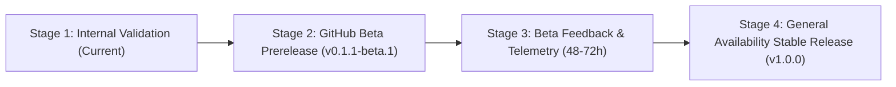

# COLLECTBOT DESKTOP — FINAL RELEASE READINESS REPORT

**Project:** CollectBot Desktop  
**Target OS:** Windows 10 & Windows 11 (x64)  
**Architecture:** Option A — Hardened Electron Shell Hosting `https://collectbot.in`  
**Current Version:** 0.1.1-beta.1  
**Overall Readiness Verdict:** **CONDITIONALLY READY FOR BETA (Gated by Production Migration)**

---

## 1. PHASE-BY-PHASE AUDIT & STATUS

| Phase | Description | Audit Status | Key Verification Evidence |
| :--- | :--- | :--- | :--- |
| **Phase 1** | Architecture Discovery & Compatibility Audit | **PASS** | Validated Next.js 16.2.10, React 19.2.4, Supabase SSR, and zero-bundle architecture. |
| **Phase 2** | Electron Shell & Secure Foundation | **PASS** | `nodeIntegration: false`, `contextIsolation: true`, `sandbox: true`, persistent partition `persist:collectbot`, offline screen. |
| **Phase 3** | Authentication & Native OS Features | **PASS** | External Google OAuth handshake, 256-bit tickets, PKCE/state nonces, native downloads, file dialogs, sanitized notifications. |
| **Phase 4** | Windows NSIS Packaging & Release Pipeline | **PASS** | `electron-builder.yml` configured, lean `app.asar` (~48 KB), per-user NSIS, CI/CD in `.github/workflows/release-desktop.yml`. |
| **Phase 5** | Auto-Updates & Channel Management | **PASS** | `electron-updater` v6.8.11, differential blockmaps, `stable`/`beta` channels, downgrade defense, financial workflow guard, circuit breaker. |

---

## 2. PRODUCTION READINESS GATES

To ensure absolute safety, production launch is governed by five strict gates:

| Gate | Gate Name | Target Requirement | Status | Required Action |
| :--- | :--- | :--- | :--- | :--- |
| **Gate 1** | **Production Database Migration** | `desktop_auth_tickets` table, indexes, and RLS created in live Supabase production. | **PENDING** | **MANDATORY BLOCKER:** The administrator must execute `supabase/migrations/20261111_desktop_auth_tickets.sql` in the Supabase Dashboard SQL Editor. Without this, desktop Google OAuth exchanges will fail. |
| **Gate 2** | **Authenticode Code Signing** | Microsoft-trusted EV/OV Authenticode certificate configured in GitHub Secrets (`WIN_CSC_LINK`, `WIN_CSC_KEY_PASSWORD`). | **PENDING** | **OPTIONAL FOR BETA / MANDATORY FOR GA:** Unsigned builds trigger Windows SmartScreen "Unknown Publisher" warnings on download. A beta release can proceed with explicit user notice. |
| **Gate 3** | **Clean VM Installation Test** | Complete end-to-end installation, sign-in, update, and uninstall on physical or virtual Windows 10/11 machines. | **NOT VERIFIED** | **RECOMMENDED:** Due to sandbox security constraints, automated GUI desktop testing cannot run interactive installers. Manual verification on a fresh Windows VM is advised. |
| **Gate 4** | **Test Suite & Type Checking** | 100% of core unit, integration, security, updater, and TypeScript checks pass. | **PASS** | **VERIFIED:** 71 test assertions across 19 suites pass with 0 failures (`npm test`). TypeScript static check passes with 0 errors (`npx tsc --noEmit`). |
| **Gate 5** | **Packaging & Differential Updates** | NSIS installer, SHA-256 checksums, update feeds (`latest.yml`, `beta.yml`), and differential blockmaps generated cleanly. | **PASS** | **VERIFIED:** Packaged `CollectBotSetup-*-x64.exe` with SHA-512 blockmaps and feed manifests. |

---

## 3. SECURITY COMPLIANCE SUMMARY

- **Zero Node.js Leakage:** Preload bridge exposes only 10 typed methods; no renderer execution or direct filesystem APIs.
- **Zero Secret Exposure:** Desktop bundle contains no `.env` files, Supabase service-role keys, Razorpay secrets, or Resend API tokens.
- **Data Preservation Guarantee:** User session cookies, business selection, and update state in `%APPDATA%\CollectBot` remain intact across binary updates and reinstalls.
- **Financial Workflow Protection:** Suppresses restart dialogs when users are drafting invoices (`/invoices/new`, `/invoices/*`), recording payments (`/payments/*`), or managing deals (`/deals/*`).
- **Update Loop Protection:** Halts background updates after 3 consecutive failures to prevent reboot loops.

---

## 4. STAGED ROLLOUT PLAN

1. **Stage 1 (Internal Validation):** Complete. Automated test suites pass, desktop compiled, beta installer and manifests prepared.
2. **Stage 2 (Beta Prerelease):** Await administrator execution of Gate 1 (Supabase migration). Once confirmed, publish `v0.1.1-beta.1` to GitHub Releases with `prerelease: true`.
3. **Stage 3 (Opt-in Beta Testing):** Early adopters switch channel to `beta` via `Help -> Update Channel`. Collect feedback on login, invoice printing, and notifications.
4. **Stage 4 (General Availability):** Upon code-signing certificate acquisition and beta stabilization, publish `v1.0.0` to the `stable` channel.

